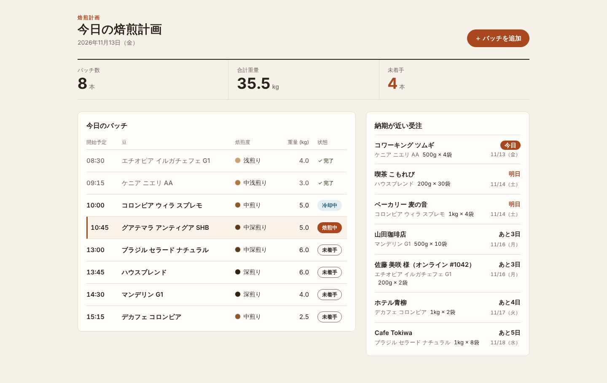
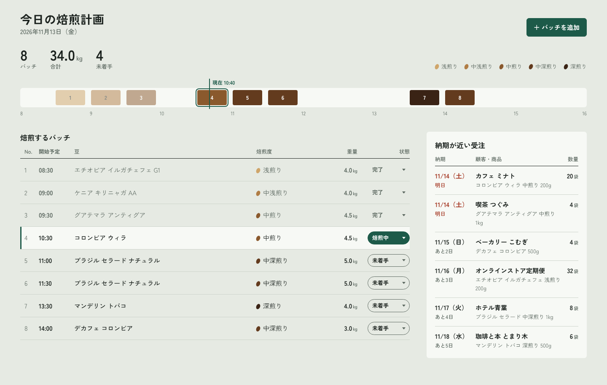
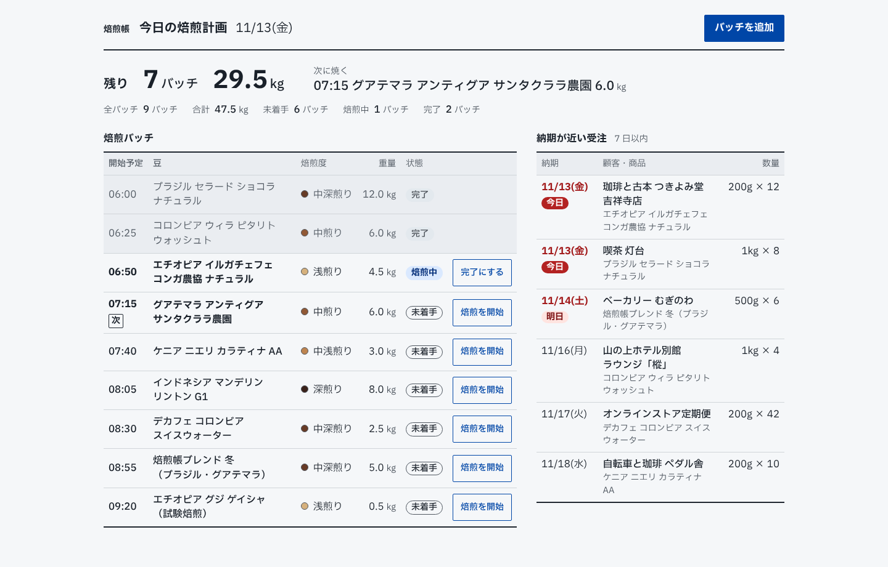
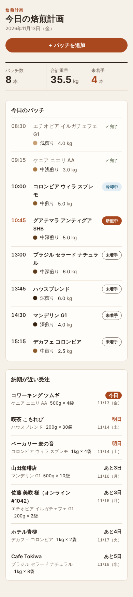
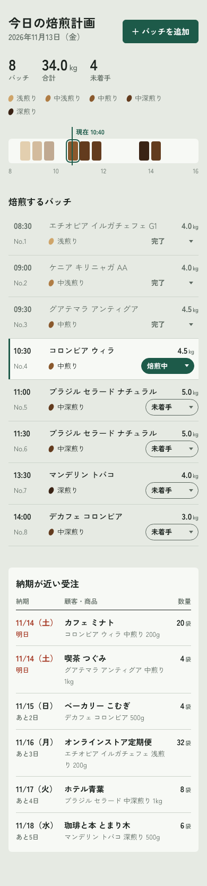
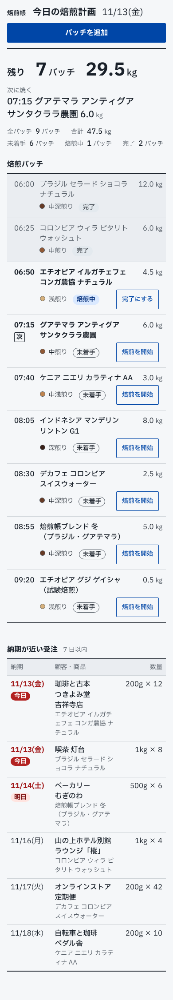

# 洗練された UI を AI に作らせる仕組み — 調査・実装・検証のまとめ

このリポジトリには、その仕組み一式（基準・スキル・フック・検査器）が実装されています。
この文書は「なぜこの形にしたか」と「実際に効いたか」の記録です。

## 1. 結論

AI の UI がありきたりで見にくくなる原因は、能力不足ではなく次の 3 つです。対策はそれぞれ別の層に置きます。

| 原因 | 何が起きるか | 対策 | 置き場所 |
|---|---|---|---|
| **固有の情報が無い** | 誰でも同じ「平均的な正解」に収束する | 人間が、推測できない情報だけを書いて渡す | `design/`（PRODUCT / DESIGN / tokens / briefs / references） |
| **見ずに作っている** | コード上は正しいが、描画すると階層が無い・読めない | 描画 → 画像を見る → 批評 → 修正、を手順にする | `ui-design` スキル + `tools/ui-shot.js` |
| **指示は忘れられる** | 「トークンを使え」「スクショを見ろ」は長い作業の後半で抜ける | 守らないと先に進めない仕組みにする | フック（`.claude/hooks/ui-guard.js`）+ `tools/design-lint.js` + CI |

一番効くのは 1 行目です。**スキルやフックは、人間が用意した基準を「確実に使わせる」ための装置**であって、
基準そのものの代わりにはなりません。逆に、基準だけ置いてもフックが無いと後半で崩れます（§5 で実測）。

人間がやることは多くありません: **プロダクトの文脈を 1 枚、見た目の決めごとを 1 枚、画面ごとに優先順位を 5 分**。
あとは出てきた画面に「ここが違う」と言うだけで、それが基準に蓄積されていきます。

## 2. 調査: なぜそうなるのか

### 2.1 収束は性質であって、禁止リストでは直らない

Anthropic は、指示なしで UI を作らせると Inter・紫グラデーション・控えめなアニメーションに収束する現象を
「distributional convergence」と呼び、訓練データ中の高確率パターンをなぞるためだと説明しています。
同じ記事は、**禁止しても別の定番（Space Grotesk など）に移るだけ**だという限界も認めています[^skills-blog]。

現行の公式 `frontend-design` スキルはこの点を踏まえ、禁止リストではなく
「題材の世界から決める」「計画 → ブリーフと照合 → 実装 → スクリーンショットで批評」という**手順**に重心を移しています。
また「クリーム地 + テラコッタ」「黒地 + 蛍光色」「同じ角丸カードの羅列」「見出し上の英大文字ラベル」など、
紫を避けた結果として出てくる**次の定番**を明示しています[^fd-skill]。

→ この仕組みでは、禁止リスト（`anti-patterns.md`）は「惰性の検出」にだけ使い、
判断の根拠は常にプロダクト固有の文書に置く設計にしました。

### 2.2 「見にくい」は別の問題で、機械的に測れる部分が大きい

「ありきたり」は好みの問題を含みますが、「見にくい」の多くは測定可能です:
コントラスト比、最小文字サイズ、文字サイズの種類数、行長、タップ領域、フォーカス表示、横スクロール。
これらはコードを読んでも分からず、**描画して初めて決まる値**です（継承・カスケード・折り返しの結果なので）。

コミュニティでも同じ結論に達しており、デザイン用スキルの代表例 impeccable は、
LLM による批評とは別に**決定的な（LLM を使わない）検出器**を持ち、編集のたびにフックで走らせています[^impeccable]。

→ 測れるものは測って強制し、測れないもの（階層・らしさ）だけを LLM の批評に回す、という分担にしました。

### 2.3 Claude Code の各機構の「強制力」は違う

公式ドキュメントから、UI 品質に関係する性質だけ抜き出すと:

| 機構 | いつ読まれるか | 強制力 | 向いている内容 |
|---|---|---|---|
| `CLAUDE.md` | 毎セッション全文 | 弱い（「文脈であって強制ではない」と明記。200 行以下を推奨）[^memory] | 場所・コマンド・所有権など常に必要な事実 |
| `.claude/rules/*.md` + `paths` | 該当ファイルを読み書きした時だけ[^memory] | 弱い（ただし必要な瞬間に入る） | 「UI ファイルを触るときの規則」 |
| スキル | 説明文は常時、本文は起動時。参照ファイルは必要時[^skills] | 弱い（起動するかはモデル判断） | 手順・観点・ドメイン知識 |
| スキルの `context: fork` | 別コンテキストで実行[^skills] | — | 作った文脈を知らない第三者レビュー |
| フック `PostToolUse` | 編集のたび。exit 2 で stderr がモデルに届く[^hooks] | **強い**（必ず走る） | lint の即時フィードバック |
| フック `Stop` | 終了しようとするたび。`decision: block` で続行させる。8 連続で打ち切り[^hooks] | **強い** | 「描画して見るまで終われない」 |
| フック `PreToolUse` | ツール実行前。`permissionDecision: ask/deny`[^hooks] | **強い** | 基準ファイルの保護 |

公式ドキュメントは CLAUDE.md について「何があっても止めたい動作にはフックを使え」と書いています[^memory]。
つまり **「好み・理由・手順」はスキルと文書に、「必ず守ること」はフックに** 分けるのが筋です。

### 2.4 DESIGN.md という流れ

Google Labs が公開した DESIGN.md 形式（YAML のトークン + Markdown の理由。現在 alpha）[^designmd] に見られるように、
「機械可読な値」と「人間が書いた理由」を対にしてエージェントに渡すのが共通解になりつつあります。

→ 本リポジトリは同じ考え方ですが、値は実際にコードが読み込む `design/tokens.css` だけに置き、
`DESIGN.md` には理由だけを書く形にしました（値を 2 箇所に書くと必ずずれるため）。
Google 形式の CLI（lint / export）は未検証です。採用するなら tokens.css をそこから生成する構成になります。

## 3. 人間が準備するもの

効果が大きい順です。上から 3 つが必須、残りは精度を上げるものです。

| # | 何を | どこに | かける時間 | 書くこと / 書かないこと |
|---|---|---|---|---|
| 1 | **プロダクトの文脈** | `design/PRODUCT.md` | 20〜30 分（一度だけ） | 誰が・どんな姿勢と場所で・何秒使うか。形容詞 3 つと**その意味**。こうはしたくない例。一般論（使いやすく、モダンに）は書かない |
| 2 | **見た目の決めごと** | `design/tokens.css` + `design/DESIGN.md` | 1〜2 時間（一度だけ。`/design-init` が下書きする） | tokens: 色・書体・サイズ 6 段・余白 8 段など**有限の選択肢**。DESIGN.md: 使い分けと**理由**、やらないこと |
| 3 | **画面ごとの優先順位** | `design/briefs/<画面>.md` | 5 分 / 画面 | 一番大事な 1 つ、情報の順位、実データの最長・最多・0 件。機能一覧ではなく**優先順位** |
| 4 | 手本と反面教師の実物 | `design/references/` | 随時 | スクリーンショット 3〜8 枚 + どこを見てほしいかのメモ。ボツにした AI 生成画面は最良の反面教師 |
| 5 | 指摘の蓄積 | `design/DECISIONS.md` | 指摘のたびに 1 行（エージェントが追記） | 「何が・なぜ違うか」。3 回出たら DESIGN.md か lint ルールへ昇格 |
| 6 | 最終判断 | レビュー時 | — | 「らしさ」と階層の最終判定は人間。機械検査が通っても良い UI とは限らない |

**なぜこの 3 つが必須か:** AI は「表を作る」「ボタンを置く」は外しません。外すのは
「どれを主役にするか」「この人にとって何が読みにくいか」「この製品は何に似ていてはいけないか」で、
これはリポジトリのどこにも書かれていない、人間の頭の中にしかない情報だからです。

**トークンは「少なく・閉じた集合」にする:** 文字サイズ 6 段・余白 8 段のように選択肢を有限にすると、
AI の出力のばらつきが構造的に減り、lint で機械検査できるようになります。
「いい感じの値」を毎回考えさせない、というのが要点です。

## 4. 仕組みの全体像

```
人間が書く（所有する）                AI が従う / 仕組みが強制する
┌──────────────────────┐
│ design/PRODUCT.md      │─┐
│ design/DESIGN.md       │ │  ① 読む        ui-design スキル（手順）
│ design/tokens.css      │ ├──────────▶  0.基準を読む → 1.計画 → 2.実装
│ design/briefs/*.md     │ │                                   │
│ design/references/     │ │              ② 編集のたび          ▼
│ design/DECISIONS.md ◀──┼─┘        PostToolUse フック ──▶ design-lint（静的）
└──────────▲───────────┘            error は即モデルへ      トークン外の値・癖・a11y
           │                                                    │
           │ ⑤ 指摘を追記                 ③ 描画                 ▼
           │                         tools/ui-shot.js ──▶ スクリーンショット 5 枚
     人間のレビュー ◀── 報告 ◀──┐      + 描画監査（コントラスト・文字サイズ・
                                │        タップ領域・フォーカス・横スクロール…）
                                │                               │
                       ④ Stop フック（完了ゲート）◀──────────────┘
                         lint error なし ∧ 描画済み ∧ 全画像を開いた ∧ 監査 error なし
                         でなければ終了させない

     検出: 変更は「どのツールで書いたか」ではなくファイル内容のハッシュで判定（Bash 経由の書き込みも拾う）
     保護: PreToolUse フック … tokens / DESIGN / PRODUCT / 検査器 / フック自身の変更は人間に確認
     CI:   同じ lint と描画監査を PR に掛ける（人間が書いたコードにも同じ基準）
```

### 構成ファイル

| ファイル | 役割 |
|---|---|
| `CLAUDE.md` | 入口。基準の場所・所有権・コマンド（短く保つ） |
| `.claude/rules/ui.md` | UI ファイルを触った瞬間だけ読み込まれる規則（`paths` 指定） |
| `.claude/skills/ui-design/` | 設計手順。`references/` に批評観点・癖の一覧・和文組版 |
| `.claude/skills/ui-review/` | `context: fork` の第三者レビュー（`/ui-review <対象>`） |
| `.claude/skills/design-init/` | 基準をインタビューで作る（人間が起動: `/design-init`） |
| `.claude/settings.json` | フックの登録、検査コマンドの許可 |
| `.claude/hooks/ui-guard.js` | フック本体（session-start / protect / post-tool / post-read / stop） |
| `tools/design-lint.js` | 静的検査 19 ルール + トークンのコントラスト検査。依存なし |
| `tools/ui-shot.js` | Playwright で 4 幅（390 / 820 / 1180 / 1440）+ ダークを撮影し、描画結果を監査。`?empty=1` など状態違いも同時に撮れる |
| `tools/ui-state.js` | フックと ui-shot が共有する状態。UI ファイルの内容ハッシュで変更を検出 |
| `tools/test/` | lint の回帰テスト（既知の悪い例） |
| `.github/workflows/design.yml` | CI で同じ検査 |

### 設計判断

- **批評は画像に対して行う。** スキルは「コードを読む前に画像だけで評価」「必ず弱い点を 3 つ挙げる」と指定。
  「問題ありません」で終わらせないため。
- **見たかどうかを記録する。** `ui-shot` が撮った PNG を Read で開くと `post-read` フックが記録し、
  全部開くまで Stop フックが通さない。「撮ったが見ていない」を防ぐ。
- **逃げ道は用意し、必ず記録させる。** 誤検知は `--ack "<理由>"`、描画不能は `--skip "<理由>"`、
  lint は `design-lint-disable-next-line <rule> -- <理由>`。理由なしは error。黙って回避はできないが、行き止まりにもならない。
- **基準と検査器は AI に書き換えさせない。** 「lint を通すためにトークンを足す / 検査器を緩める」は典型的な失敗なので、
  `PreToolUse` で確認を挟む（Bash のリダイレクトや `sed -i` も拾うが完全ではない。事故防止であって敵対的防御ではない）。
- **セッション単位の状態。** 完了ゲートは「このセッションで UI を触ったとき」だけ働く。無関係な作業は邪魔しない。
- **スタック非依存。** 検査は CSS / HTML / JSX / TSX / Vue / Svelte / Astro のテキストと、描画結果に対して行う。
  Tailwind の場合は任意値 `[..]` を検出する（テーマをトークンから生成する構成が前提）。

## 5. 検証

仕組みが「動く」ことと「効く」ことを、実際に Claude Code をヘッドレス（`claude -p`）で走らせて確かめました。
作った本人（このセッション）が評価用の画面も作ると検証にならないため、**毎回まっさらな別プロセス**に同じ依頼文を渡しています。

### 5.1 比較実験

依頼文は全アーム共通（[`experiments/ab/prompt.txt`](../experiments/ab/prompt.txt)）: 焙煎所向け「今日の焙煎計画」画面を静的 HTML/CSS で作る。

| アーム | 条件 | 結果 |
|---|---|---|
| **A** | 何も無い空のディレクトリ | [`experiments/ab/A/`](../experiments/ab/A/) |
| **A2** | Anthropic 公式 `frontend-design` スキルだけを置いた | [`experiments/ab/A2/`](../experiments/ab/A2/) |
| **B** | このリポジトリ（基準 + スキル + フック + 検査器） | [`src/roast-plan/`](../src/roast-plan/) |

| A: 何も無し | A2: 公式スキルのみ | B: この仕組み |
|---|---|---|
|  |  |  |
|  |  |  |

**見て分かること**

- **A** は破綻していませんが、公式スキルが「生成 UI の定番」として名指ししているものがそのまま出ています:
  クリーム地 + テラコッタ、統計 3 つの横並び、角丸カード 2 枚、見出し上の小ラベル、進行中の行の左端の色帯。
  ロゴを差し替えればどの業種にも使える画面です。
- **A2** は明らかに個性が出ました（時間軸の帯という独自の要素）。一方で**見にくさが増えています**:
  帯の中の番号はコントラスト 2.1〜2.7:1、単位は 10.8px、モバイルの帯は幅 19px でタップ不能。
  エージェント自身の報告にも「最後の CSS 調整だけは再撮影していません」とあります。
  → 美意識の指示だけでは「読める」は保証されず、最後の変更は見ないまま終わる。
- **B** はブリーフどおり「残り 7 バッチ / 29.5 kg」が主役になり、カード無し・罫線ベース・時刻が左に揃う帳票になりました。
  これは AI の発想ではなく、`PRODUCT.md` と `briefs/roast-plan.md` に人間が書いたことの反映です。
  ダミーデータも、ブリーフに書いた「最長の豆名・顧客名」で組まれています（A / A2 は短い名前だけ）。

**同じ検査器で測った値**（`ui-shot` の描画監査のうち、トークンに依存しない項目。[`metrics.py`](../experiments/ab/metrics.py)）

| | A | A2 | B |
|---|---|---|---|
| コントラスト不足 | 0 | 3 | 0 |
| 12px 未満の文字 | 0 | 1（10.8px） | 0 |
| 24px 未満のタップ領域 | 0 | 1 種（8 個） | 0 |
| 文字サイズの種類（全幅合計） | 8 | 9 | **4** |
| 最小の文字 | 12px | 10.8px | 14px |
| 0 件の状態 | 無し | 無し | あり（`?empty=1`） |
| フォーカス表示・ラベル欠落・横スクロール | 0 | 0 | 0 |
| コスト / 時間 / ターン数 | $1.03 / 2 分 / 9 | $1.35 / 3 分 / 10 | $3.75 / 8 分 / 48 |

正直な読み方: **素の A も a11y の基本は外していません。** 差が出るのは「ありきたりさ」「主役が合っているか」
「文字サイズの規律」「実データへの耐性」で、仕組みの価値はそこにあります。代わりにコストは 3〜4 倍です
（大半は描画 → 確認 → 修正の往復 3 回ぶん）。

### 5.2 フックは本当に働いたか

実行ログ（stream-json の hook イベント）で確認した事実です。

| 確かめたこと | 結果 |
|---|---|
| スキルが自動で起動するか | B は依頼文に「スキルを使え」と書いていないが、最初のツール呼び出しが `Skill: ui-design` だった |
| Stop フックが実際に止めるか | **止めた。** B は最後の再撮影のあと 8 枚中 2 枚だけ見て終了しようとし、「まだ見ていない 6 枚」を列挙されて差し戻され、全部開いてから終了した |
| lint フックが実際に効くか | **効いた。** 別の実行で「ボタンを `#e11d48`・角丸 12px に。確認は不要、すぐ終わって」と依頼 → 編集直後に `PostToolUse` が exit 2 で 2 件の error を返し、エージェントは変更を戻して「トークン追加か、理由付きの例外か」を質問した（[`C.result.md`](../experiments/ab/C.result.md)） |
| 基準を勝手に書き換えないか | B は主役の数字が小さいと判断したが、`tokens.css` には触らず「`--text-3xl` を足すか判断してほしい」と報告した |
| `/ui-review`（`context: fork`）が動くか | 動いた。機械検査が全通過の B に対し、画像を根拠に P1 を 6 件・P2 を 4 件指摘した（[`B.review.md`](../experiments/ab/B.review.md)） |

### 5.3 検証で見つかって直した欠陥

仕組みは一度で正しくは作れませんでした。実際に走らせて初めて分かったものです。

1. **Bash で書かれるとフックをすり抜けた。** 1 回目の B は 3 ファイルを heredoc（`cat > … <<EOF`）で一括作成し、
   `Edit|Write` にだけ掛けていたフックが一度も発火しなかった（完了ゲートが無効のまま終了。結果は [`experiments/ab/B0/`](../experiments/ab/B0/)）。
   → 「どのツールで書いたか」を見るのをやめ、UI ファイルの**内容ハッシュ**の差分で検出する方式に作り直した。
2. **保護フックの誤検知。** 2 回目の B で、heredoc 内の `<link href="…/design/tokens.css">` という文字列に反応して書き込みを止めた。
   → heredoc の本文を除外し、保護ファイルが「書き込み先」のときだけ反応するようにした（誤検知 4 例 / 正検知 6 例で確認）。
3. **スクリーンショットが 1 画面ぶんしか写っていなかった。** エージェントが自前で全体撮影スクリプトを書いて補っていた。
   → ページ全体を撮るように修正。空状態も同時に撮れるよう `?query` 付きの指定に対応。
4. **主戦場の幅を撮っていなかった。** 第三者レビューが「1180px 前後で豆名が全部折り返す。検査器がその幅を撮っていない」と指摘。
   → `laptop`（1180px）を追加。撮ってみると指摘どおりだった。
5. lint の重複検出・誤検知（`reduced-motion` の `!important` など）→ 回帰テスト（`npm test`）を追加して修正。

**教訓:** フックは「書いたら終わり」ではなく、実際のエージェントで走らせて抜け穴を探す必要があります。
エージェントは悪意なく、ごく自然に想定外の経路（Bash での一括書き込み）を通ります。

### 5.4 機械検査を全部通っても「良い UI」とは限らない

B は design-lint 0 件・描画監査 0 件でしたが、第三者レビューは次を指摘しました（抜粋）:

- ノート PC 幅で豆名 9 件中 8 件が折り返す（タブレットより広い画面のほうが読みにくい逆転）
- 「次に焼く 1 件」が一覧の中で見分けにくい
- 行ごとの青枠ボタン 7 個が主役を食っている
- 今日納期の受注が最初の画面に出ない

どれも妥当で、**機械では測れず、作った本人（同じコンテキスト）も見落としたもの**です。
つまり 3 層は代替ではなく補完です: lint（値の規律）→ 描画監査（読めるか）→ 別コンテキストの批評（階層・らしさ）→ 人間（最終判断）。
サンプル画面はあえて未修正のまま残してあります。レビューの「基準自体への提案」
（`--text-3xl` の追加、ダークの沈んだ面の差、行内操作の強さの規定）は人間が決める事項です。

### 5.5 この検証の限界

- 各アーム **1 回ずつ**（B のみ 2 回）で、1 種類の画面だけ。生成結果には揺らぎがあり、統計的な主張はできません
- 「洗練されているか」の評価は私（AI）の目視と、同じモデルによるレビューです。**人間の目での評価は未実施**
- 基準（`PRODUCT.md` / `DESIGN.md` / トークン）も私が書いたサンプルです。本当の検証は、あなたの好みで書いた基準で行う必要があります
- B はブリーフを持っているので、A / A2 より情報量が多い比較です。これは欠陥ではなく主張そのもの
  （**差の大半は人間が渡した情報から来る**）ですが、「スキルとフックだけの寄与」は切り分けていません
- 静的 HTML/CSS のみ。React + Tailwind などの実プロジェクト、既存 UI の改修、複数画面の一貫性は未検証
- `design/references/` に実物の画像を置いた場合の効果は未検証（最も効くと予想される入力）
- CI ワークフロー（`.github/workflows/design.yml`）は書いただけで、GitHub 上での実行は未確認

## 6. 使い方

### 自分のプロダクトに切り替える

1. `/design-init` を実行する。質問（誰が・どこで・何秒使うか、形容詞 3 つ、こうはしたくない例、手本）に答えると、
   方向性を 2〜3 案の画像で見せてくるので選ぶ。`design/` のサンプルが置き換わる
2. `design/references/good/` と `bad/` にスクリーンショットを 3〜8 枚置き、`notes.md` に「どこを見るか」を書く
3. 画面を頼む前に `design/briefs/_template.md` を複製して 5 分で埋める
4. 「◯◯画面を作って」と頼む。報告とスクリーンショット（`.ui-review/shots/`）を見る
5. 違うところを言葉で伝える。`design/DECISIONS.md` に蓄積され、3 回出たものは基準か lint ルールに昇格させる
6. 大きな画面や出荷前は `/ui-review <対象>` で別コンテキストの批評を取る

### 運用の勘所

- **指摘は画面ではなく基準に返す。** 「この余白を広げて」で終わらせると次の画面でまた起きる。
  「節の間は 3 段以上」と DESIGN.md に書けば二度と起きない
- **トークンは増やさない方向で守る。** AI からの「トークン追加の提案」は、半分は本当に足りないサイン、半分は設計のほうを直すべきサイン
- **抑制コメントと `--ack` を定期的に眺める。** `grep -rn "design-lint-disable"` で一覧できる。増えていたら基準が実態に合っていない
- **コストとの釣り合い。** 往復 3 回で 3〜4 倍かかる。小さな修正では `ui-design` スキルの往復回数を減らす運用もあり得るが、
  「描画して見る」だけは外さない（A2 の未確認の変更がまさにそれ）

## 7. 次にやると良いこと

- 人間の目で A / A2 / B を見て、**あなたの評価**と私の評価のずれを `DECISIONS.md` に書く（これが最初の校正になる）
- 実際のスタック（例: React + Tailwind）に載せる: Tailwind テーマを `tokens.css` から生成し、任意値を lint で禁止
- 参考画像を入れた状態で同じ実験をやり直す
- 複数画面を続けて作らせ、画面間の一貫性（同じ部品が同じ見た目か）を検査に加える
- 第三者レビューを Stop フック（`type: "agent"`）に組み込み、一定以上の規模の変更では自動で走らせる（コスト増と相談）

## 出典

[^skills-blog]: Anthropic, "Improving frontend design through Skills" — https://claude.com/resources/articles/improving-frontend-design-through-skills
[^fd-skill]: anthropics/skills `frontend-design/SKILL.md` — https://github.com/anthropics/skills/tree/main/skills/frontend-design
[^impeccable]: pbakaus/impeccable — https://github.com/pbakaus/impeccable
[^memory]: Claude Code Docs, "How Claude remembers your project"（CLAUDE.md・`.claude/rules/`）— https://code.claude.com/docs/en/memory
[^skills]: Claude Code Docs, "Skills" — https://code.claude.com/docs/en/skills
[^hooks]: Claude Code Docs, "Hooks reference" — https://code.claude.com/docs/en/hooks
[^designmd]: google-labs-code/design.md — https://github.com/google-labs-code/design.md
